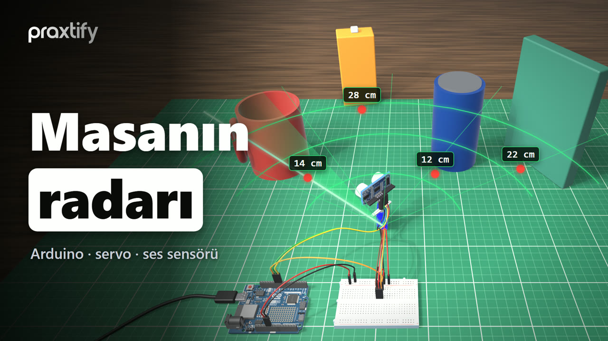
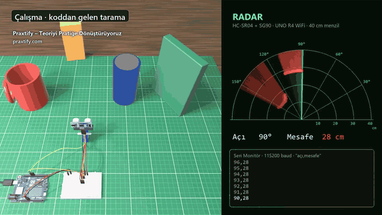
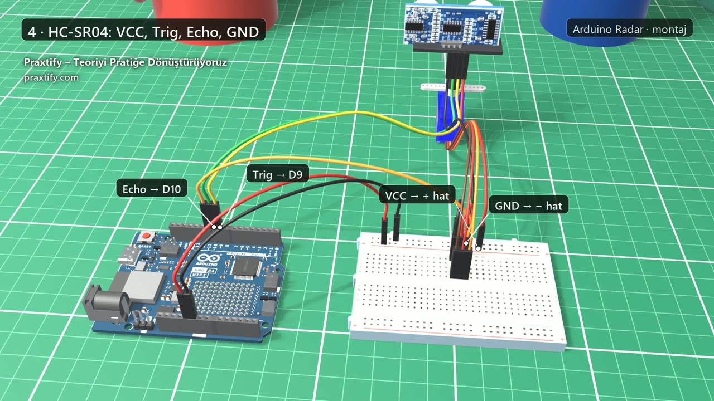
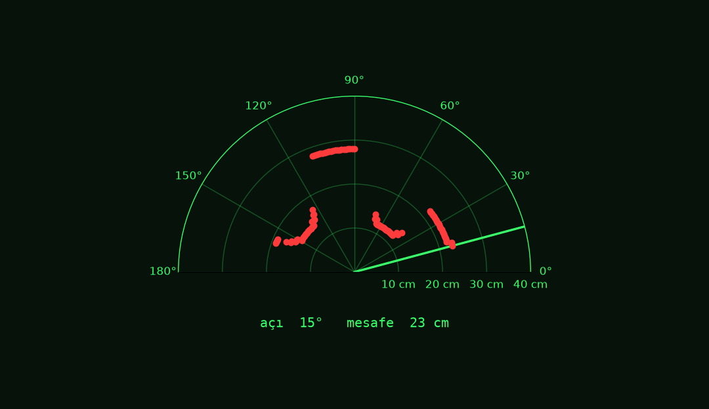
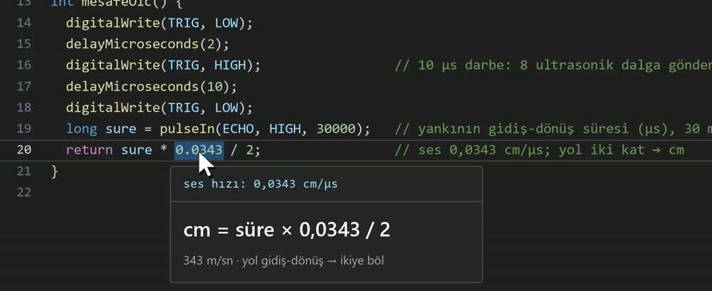
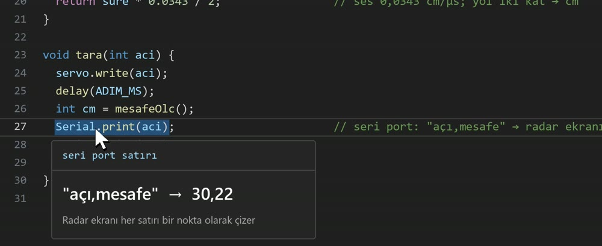

<a id="top"></a>

<div align="center">



### 🇬🇧 [English](#en) &nbsp;·&nbsp; 🇹🇷 [Türkçe](#tr) &nbsp;·&nbsp; 🇩🇪 [Deutsch](#de)

</div>

---

<a id="en"></a>

<div align="center">

🇬🇧 **English** &nbsp;·&nbsp; 🇹🇷 [Türkçe](#tr) &nbsp;·&nbsp; 🇩🇪 [Deutsch](#de)

# Ultrasonic Radar with Arduino · UNO R4 WiFi + SG90 + HC-SR04

[](https://www.youtube.com/@praxtify)
[](https://praxtify.com)

**With a servo, a sound sensor and an Arduino, we map the desk like a radar.** The SG90 servo sweeps the HC-SR04 ultrasonic sensor
from 15° to 165°. At every degree the distance is computed from the echo's return time and written to the serial port as `angle,distance`.
The **radar display** on the computer reads these lines and draws them on a semicircular radar.

[](https://docs.arduino.cc/hardware/uno-r4-wifi/)
[](https://www.python.org/)
[](LICENSE)
[](https://www.youtube.com/@praxtify)

</div>

<p align="center">
  
</p>

---

## Contents

- [What you'll learn](#what-youll-learn)
- [Hardware](#hardware)
- [Wiring](#wiring)
- [Upload the code](#upload-the-code)
- [Radar display](#radar-display)
- [Project structure](#project-structure)
- [How it works](#how-it-works)
- [Try it yourself](#try-it-yourself)
- [Credits and licenses](#credits-and-licenses)
- [Praxtify](#praxtify)

## What you'll learn

| Topic | In this project |
|---|---|
| Ultrasonic measurement | A 10 µs trigger pulse to the HC-SR04, echo time with `pulseIn`, centimetres from the speed of sound |
| Servo control | Turning the SG90 degree by degree with the `Servo` library |
| Serial communication | Sending each measurement to the computer as an `angle,distance` line |
| Visualisation | Drawing the serial port lines on a semicircular radar display in Python |

The whole Arduino code is **a single file, 42 lines**: [`radar/radar.ino`](radar/radar.ino). It is identical to the code explained in the video.

## Hardware

| Part | Role |
|---|---|
| **Arduino UNO R4 WiFi** | Turns the servo, triggers the sensor, writes the measurement to the serial port |
| **SG90 micro servo** | Sweeps the sensor between 15° and 165° |
| **HC-SR04 ultrasonic sensor** | Sends a sound wave and reports the echo's return time (about 2–400 cm) |
| **Breadboard** | Distributes the 5 V and GND rails |
| Jumper wires + 3-pin header | Connections |
| USB-C cable | Power and serial port |

The sensor is mounted on the servo horn; as the servo turns, the sensor scans its surroundings.

## Wiring

<p align="center"></p>

| From | To | Wire |
|---|---|---|
| Arduino **5V** | Breadboard **+** rail | red |
| Arduino **GND** | Breadboard **−** rail | black |
| SG90 brown (GND) | **−** rail | black |
| SG90 red (5V) | **+** rail | red |
| SG90 orange (signal) | Arduino **D11** | orange |
| HC-SR04 **VCC** | **+** rail | red |
| HC-SR04 **GND** | **−** rail | black |
| HC-SR04 **Trig** | Arduino **D9** | yellow |
| HC-SR04 **Echo** | Arduino **D10** | green |

The servo plug goes onto the 3-pin header on the breadboard; wires run from the holes next to the header to the rails.
Finally, plug in the USB-C cable: both power and the serial port go through it.

> [!TIP]
> The SG90 draws current spikes while moving. If the servo jitters or the Arduino resets, connect the servo's + and − leads to a separate
> 5 V supply (keep the ground common with the Arduino).

## Upload the code

With the Arduino IDE: install *Arduino UNO R4 Boards* from the **Boards Manager** (the `Servo` library ships with the IDE; if it is missing,
install it from the **Library Manager**), open `radar/radar.ino`, select *Arduino UNO R4 WiFi* as the board and upload.

From the command line ([arduino-cli](https://arduino.github.io/arduino-cli/)):

```bash
git clone https://github.com/praxtify/2-arduino-radar.git
cd 2-arduino-radar

arduino-cli core install arduino:renesas_uno
arduino-cli lib install Servo

arduino-cli compile -b arduino:renesas_uno:unor4wifi radar
arduino-cli upload  -b arduino:renesas_uno:unor4wifi -p <PORT> radar   # Windows: COM3 · Linux: /dev/ttyACM0
```

Build output: **20%** of program storage (54,792 / 262,144 bytes). After uploading, open the Serial Monitor at **115200 baud**
to see the lines:

```text
28,22
29,22
30,22
31,22
```

Tested with: arduino-cli 1.5 · Arduino UNO R4 Boards 1.6.0 · Servo 1.3.0.

## Radar display

[`radar_ekrani.py`](radar_ekrani.py) reads the `angle,distance` lines from the serial port and draws them on a semicircular radar.
The sweep line shows the latest angle; the last measurement at each angle stays as a red dot and is refreshed when the servo returns to that angle.
Measurements without an echo (`0`) and points out of range are not drawn.

```bash
python -m venv .venv
# Windows:      .venv\Scripts\activate
# macOS/Linux:  source .venv/bin/activate
pip install -r requirements.txt

python radar_ekrani.py --port COM3                 # with the board (Linux: /dev/ttyACM0 · macOS: /dev/cu.usbmodem…)
python radar_ekrani.py --dosya ornek-olcum.txt     # without the board: replay the sample recording
```

> [!NOTE]
> - While the Arduino IDE's Serial Monitor is open, the port is busy; close the Serial Monitor before starting the radar display.
> - Code comments and identifiers are in Turkish (`--dosya` = file, `--menzil` = range, `tara` = scan, `mesafeOlc` = measure distance).

To try it without a board there is [`ornek-olcum.txt`](ornek-olcum.txt): one full sweep of the scene in the video (right to left and back,
302 measurements). When the recording ends, it starts over. To save a single image without opening a window:

```bash
python radar_ekrani.py --dosya ornek-olcum.txt --png radar.png
```

<p align="center"></p>

The four objects in the image are the same as in the video: **a book at 30°** (22 cm), **a tin at 55°** (12 cm), **a juice box at 100°**
(28 cm), **a mug at 140°** (14 cm). You can change the range with e.g. `--menzil 100` (default 40 cm).

Tested with: Python 3.13 · Matplotlib 3.11 · NumPy 2.5 · pySerial 3.5 (Windows 11).

## Project structure

```text
2-arduino-radar/
├── radar/
│   └── radar.ino           # Arduino code (as in the video)
├── radar_ekrani.py         # serial port → semicircular radar display
├── ornek-olcum.txt         # sample serial port recording for trying it without a board
├── requirements.txt        # matplotlib, numpy, pyserial (radar display only)
├── docs/                   # README images
└── LICENSE                 # MIT (project code)
```

## How it works

### 1 · Pins and sweep limits

```cpp
const int TRIG = 9;                         // HC-SR04 Trig → D9
const int ECHO = 10;                        // HC-SR04 Echo → D10
const int SERVO_PIN = 11;                   // SG90 sinyal (turuncu) → D11

const int BAS_ACI = 15;                     // taramanın başı (derece)
const int SON_ACI = 165;                    // taramanın sonu
const int ADIM_MS = 30;                     // her derecede servonun oturma süresi
```

The sweep runs from 15° (`BAS_ACI`, start angle) to 165° (`SON_ACI`, end angle). At every degree the servo is given 30 ms (`ADIM_MS`) to settle; the measurement is taken after that.

### 2 · Distance measurement: the sound's round-trip time

<p align="center"></p>

A **10 µs** pulse is sent to the Trig pin; the sensor emits 8 ultrasonic waves and holds the Echo pin HIGH until the waves
return. `pulseIn` measures this time in microseconds. Sound travels 343 metres per second, i.e. **0.0343 cm** per microsecond.
Since the path is there and back, it is divided by two:

$$d\,[\text{cm}] = \frac{t\,[\mu s] \times 0.0343}{2}$$

For example, for the book at 22 cm the echo returns after about 1283 µs. The last parameter of `pulseIn` (30,000 µs) is the timeout:
if no echo arrives within 30 ms, the function returns `0` and so does the distance (out of range).

### 3 · `tara()`: turn, wait, measure, write

<p align="center"></p>

```cpp
void tara(int aci) {
  servo.write(aci);
  delay(ADIM_MS);
  int cm = mesafeOlc();
  Serial.print(aci);                        // seri port: "açı,mesafe" → radar ekranı
  Serial.print(",");
  Serial.println(cm);
}
```

Each measurement is one line: `30,22` → 22 cm at 30 degrees. Thanks to this simple format the line is easy to read in the Serial Monitor
and easy to split in Python with `split(",")`.

### 4 · Loop: right to left, left to right

```cpp
void loop() {
  for (int a = BAS_ACI; a <= SON_ACI; a++) tara(a);  // sağdan sola
  for (int a = SON_ACI; a >= BAS_ACI; a--) tara(a);  // soldan sağa
}
```

The servo goes from one end to the other and back, taking one measurement per degree. One direction is 151 measurements; with the 30 ms wait and
the measurement time each one takes about 40 ms, so a full sweep (there and back) takes about **12 seconds**.

## Try it yourself

- Set `ADIM_MS` to 15: the sweep gets faster, but do the points shift if the servo measures before it has settled?
- Set `BAS_ACI` and `SON_ACI` to 0 and 180: how does the measurement change at the SG90's limits?
- Take three measurements at the same angle and print the median: do the flickering points on the radar display decrease?
- In `radar_ekrani.py`, draw objects closer than 20 cm in a different colour: the desk's "alarm zone".

## Credits and licenses

The **project code** in this repo ([`radar.ino`](radar/radar.ino) and [`radar_ekrani.py`](radar_ekrani.py)) is released under the [MIT license](LICENSE).
The libraries used come with their own licenses and are not included in the repo:

| Component | Source | License | Installation |
|---|---|---|---|
| **Servo** Arduino library | [arduino-libraries/Servo](https://github.com/arduino-libraries/Servo) | LGPL-2.1 | ships with the IDE / Library Manager |
| **Arduino UNO R4 Boards** core | [arduino/ArduinoCore-renesas](https://github.com/arduino/ArduinoCore-renesas) | MIT | Boards Manager |
| **Matplotlib** | [matplotlib.org](https://matplotlib.org/) | Matplotlib (PSF-based) | `pip` |
| **NumPy** | [numpy.org](https://numpy.org/) | BSD 3-Clause | `pip` |
| **pySerial** | [pyserial/pyserial](https://github.com/pyserial/pyserial) | BSD 3-Clause | `pip` |

The 3D models in the images are for illustration only and are not part of the repo. The cables and the objects on the desk were modelled
in Blender by Praxtify; the Arduino UNO R4 WiFi model comes from the [GrabCAD](https://grabcad.com/library) community.
The following models are used under the [CC BY 4.0](https://creativecommons.org/licenses/by/4.0/) license (placed in the scene, scaled and rendered):

| Model | Author | Source |
|---|---|---|
| Servomotor SG90 | [Robótica Paraná](https://sketchfab.com/roboticaparana) | [Sketchfab](https://sketchfab.com/3d-models/servomotor-sg90-863b04f543a94b82ad5f660aafd997de) |
| HC-SR04 | [peddintiudaykiran176](https://sketchfab.com/peddintiudaykiran176) | [Sketchfab](https://sketchfab.com/3d-models/hc-sr04-e8a6adcef8fd4f45bf27b8d7718ed489) |
| Breadboard Arduino | [syukurmanhia3](https://sketchfab.com/syukurmanhia3) | [Sketchfab](https://sketchfab.com/3d-models/breadboard-arduino-e98f8d8a0e284b818f7540f118fb2ab5) |

## Praxtify

**Turning theory into practice.** We teach robotics, embedded systems and AI step by step, with working code.
For this project's video and new projects:

<p align="center">
  <a href="https://praxtify.com"></a>
  <a href="https://www.youtube.com/@praxtify"></a>
  <a href="https://www.instagram.com/praxtify"></a>
  <a href="https://www.tiktok.com/@praxtify"></a>
  <a href="https://x.com/praxtify"></a>
  <a href="https://www.threads.net/@praxtify"></a>
  <a href="https://www.linkedin.com/company/praxtify"></a>
  <a href="https://www.facebook.com/praxtify"></a>
  <a href="https://www.pinterest.com/praxtify"></a>
</p>

For questions, bugs or suggestions, open an [issue](../../issues). If you like the project, don't forget to give it a ⭐!

**Previous project in the series:** [1-arduino-robot-kol](https://github.com/praxtify/1-arduino-robot-kol): driving a six-servo robot arm from an Arduino over a single cable.

**Next project in the series:** an obstacle-avoiding robot: the same HC-SR04 and SG90 become the eyes of a wheeled robot. Coming very soon.

<p align="right"><a href="#top">↑ Back to top</a></p>

---

<a id="tr"></a>

<div align="center">

🇬🇧 [English](#en) &nbsp;·&nbsp; 🇹🇷 **Türkçe** &nbsp;·&nbsp; 🇩🇪 [Deutsch](#de)

# Arduino ile Ultrasonik Radar · UNO R4 WiFi + SG90 + HC-SR04

[](https://www.youtube.com/@praxtify)
[](https://praxtify.com)

**Bir servo, bir ses sensörü ve bir Arduino ile masanın radarını çıkarıyoruz.** SG90 servo, HC-SR04 ultrasonik sensörü
15°'den 165°'ye döndürür. Her derecede yankının dönüş süresinden mesafe hesaplanır ve seri porta `açı,mesafe` olarak yazılır.
Bilgisayardaki **radar ekranı** bu satırları okuyup yarım daire radarda çizer.

[](https://docs.arduino.cc/hardware/uno-r4-wifi/)
[](https://www.python.org/)
[](LICENSE)
[](https://www.youtube.com/@praxtify)

</div>

<p align="center">
  
</p>

---

## İçindekiler

- [Ne öğreneceksin?](#ne-öğreneceksin)
- [Donanım](#donanım)
- [Bağlantılar](#bağlantılar)
- [Kodu karta yükle](#kodu-karta-yükle)
- [Radar ekranı](#radar-ekranı)
- [Proje yapısı](#proje-yapısı)
- [Nasıl çalışıyor?](#nasıl-çalışıyor)
- [Kendin dene](#kendin-dene)
- [Kaynaklar ve lisanslar](#kaynaklar-ve-lisanslar)
- [Praxtify](#praxtify-1)

## Ne öğreneceksin?

| Konu | Bu projede |
|---|---|
| Ultrasonik ölçüm | HC-SR04'e 10 µs tetik darbesi, `pulseIn` ile yankı süresi, sesin hızıyla santimetre |
| Servo kontrolü | `Servo` kütüphanesiyle SG90'ı derece derece çevirme |
| Seri haberleşme | Her ölçümü `açı,mesafe` satırı olarak bilgisayara gönderme |
| Görselleştirme | Seri port satırlarını Python'da yarım daire radar ekranına çizme |

Arduino kodunun tamamı **tek dosya, 42 satır**: [`radar/radar.ino`](radar/radar.ino). Videoda anlatılan kodla birebir aynıdır.

## Donanım

| Parça | Görevi |
|---|---|
| **Arduino UNO R4 WiFi** | Servoyu çevirir, sensörü tetikler, ölçümü seri porta yazar |
| **SG90 mikro servo** | Sensörü 15°–165° arasında döndürür |
| **HC-SR04 ultrasonik sensör** | Ses dalgası gönderir, yankının dönüş süresini verir (yaklaşık 2–400 cm) |
| **Breadboard** | 5 V ve GND hatlarını paylaştırır |
| Jumper kablolar + 3'lü pin başlığı | Bağlantılar |
| USB-C kablo | Güç ve seri port |

Sensör, servonun koluna takılır; servo döndükçe sensör de etrafı tarar.

## Bağlantılar

<p align="center"></p>

| Nereden | Nereye | Kablo |
|---|---|---|
| Arduino **5V** | Breadboard **+** hattı | kırmızı |
| Arduino **GND** | Breadboard **−** hattı | siyah |
| SG90 kahverengi (GND) | **−** hattı | siyah |
| SG90 kırmızı (5V) | **+** hattı | kırmızı |
| SG90 turuncu (sinyal) | Arduino **D11** | turuncu |
| HC-SR04 **VCC** | **+** hattı | kırmızı |
| HC-SR04 **GND** | **−** hattı | siyah |
| HC-SR04 **Trig** | Arduino **D9** | sarı |
| HC-SR04 **Echo** | Arduino **D10** | yeşil |

Servonun fişi breadboard'daki 3'lü pin başlığına geçer; kablolar başlığın yanındaki deliklerden hatlara gider.
Son olarak USB-C kablosunu tak: hem güç hem seri port bu kablodan geçer.

> [!TIP]
> SG90 hareket ederken anlık akım çeker. Servo titrerse ya da Arduino yeniden başlıyorsa servonun + ve − uçlarını ayrı bir
> 5 V kaynağa bağla (toprağı Arduino ile ortak tut).

## Kodu karta yükle

Arduino IDE kullanıyorsan: **Boards Manager**'dan *Arduino UNO R4 Boards*'u kur (`Servo` kütüphanesi IDE ile gelir; yoksa
**Library Manager**'dan kur), `radar/radar.ino`'yu aç, kart olarak *Arduino UNO R4 WiFi*'yi seçip yükle.

Komut satırından ([arduino-cli](https://arduino.github.io/arduino-cli/)):

```bash
git clone https://github.com/praxtify/2-arduino-radar.git
cd 2-arduino-radar

arduino-cli core install arduino:renesas_uno
arduino-cli lib install Servo

arduino-cli compile -b arduino:renesas_uno:unor4wifi radar
arduino-cli upload  -b arduino:renesas_uno:unor4wifi -p <PORT> radar   # Windows: COM3 · Linux: /dev/ttyACM0
```

Derleme çıktısı: program alanının **%20**'si (54 792 / 262 144 bayt). Yükledikten sonra Seri Monitör'ü **115200 baud**'da
açarsan satırları görürsün:

```text
28,22
29,22
30,22
31,22
```

Test edilen ortam: arduino-cli 1.5 · Arduino UNO R4 Boards 1.6.0 · Servo 1.3.0.

## Radar ekranı

[`radar_ekrani.py`](radar_ekrani.py) seri porttan gelen `açı,mesafe` satırlarını okur ve yarım daire radarda çizer.
Tarama çizgisi son açıyı gösterir; her açının son ölçümü kırmızı nokta olarak kalır ve servo o açıya döndüğünde tazelenir.
Yankı gelmeyen ölçümler (`0`) ve menzil dışı noktalar çizilmez.

```bash
python -m venv .venv
# Windows:      .venv\Scripts\activate
# macOS/Linux:  source .venv/bin/activate
pip install -r requirements.txt

python radar_ekrani.py --port COM3                 # kartla (Linux: /dev/ttyACM0 · macOS: /dev/cu.usbmodem…)
python radar_ekrani.py --dosya ornek-olcum.txt     # kart olmadan: örnek kaydı oynat
```

> [!NOTE]
> Arduino IDE'nin Seri Monitörü açıkken port meşgul olur; radar ekranını çalıştırmadan önce Seri Monitör'ü kapat.

Kart olmadan denemek için [`ornek-olcum.txt`](ornek-olcum.txt) var: videodaki sahnenin bir tam turu (sağdan sola ve geri,
302 ölçüm). Kayıt bittiğinde baştan oynar. Pencere açmadan tek bir görüntü kaydetmek için:

```bash
python radar_ekrani.py --dosya ornek-olcum.txt --png radar.png
```

<p align="center"></p>

Görüntüdeki dört nesne videodakilerle aynı: **30°'de kitap** (22 cm), **55°'de teneke** (12 cm), **100°'de meyve suyu kutusu**
(28 cm), **140°'de kupa** (14 cm). Menzili `--menzil 100` gibi değiştirebilirsin (varsayılan 40 cm).

Test edilen ortam: Python 3.13 · Matplotlib 3.11 · NumPy 2.5 · pySerial 3.5 (Windows 11).

## Proje yapısı

```text
2-arduino-radar/
├── radar/
│   └── radar.ino           # Arduino kodu (videodaki)
├── radar_ekrani.py         # seri port → yarım daire radar ekranı
├── ornek-olcum.txt         # kart olmadan denemek için örnek seri port kaydı
├── requirements.txt        # matplotlib, numpy, pyserial (yalnız radar ekranı için)
├── docs/                   # README görselleri
└── LICENSE                 # MIT (proje kodu)
```

## Nasıl çalışıyor?

### 1 · Pinler ve tarama sınırları

```cpp
const int TRIG = 9;                         // HC-SR04 Trig → D9
const int ECHO = 10;                        // HC-SR04 Echo → D10
const int SERVO_PIN = 11;                   // SG90 sinyal (turuncu) → D11

const int BAS_ACI = 15;                     // taramanın başı (derece)
const int SON_ACI = 165;                    // taramanın sonu
const int ADIM_MS = 30;                     // her derecede servonun oturma süresi
```

Tarama 15° ile 165° arasında yapılır. Her derecede servoya 30 ms verilir, yerine otursun; ölçüm ondan sonra alınır.

### 2 · Mesafe ölçümü: sesin gidiş-dönüş süresi

<p align="center"></p>

Trig pinine **10 µs**'lik bir darbe gönderilir; sensör 8 ultrasonik dalga yollar ve dalgalar dönene kadar Echo pinini HIGH
tutar. `pulseIn` bu süreyi mikrosaniye olarak ölçer. Ses saniyede 343 metre, yani mikrosaniyede **0,0343 cm** gider.
Yol gidiş-dönüş olduğu için ikiye bölünür:

$$d\,[\text{cm}] = \frac{t\,[\mu s] \times 0{,}0343}{2}$$

Örneğin 22 cm'deki kitap için yankı yaklaşık 1283 µs'de döner. `pulseIn`'in son parametresi (30 000 µs) bekleme sınırıdır:
yankı 30 ms içinde gelmezse fonksiyon `0` döndürür, mesafe de `0` olur (menzil dışı).

### 3 · `tara()`: çevir, bekle, ölç, yaz

<p align="center"></p>

```cpp
void tara(int aci) {
  servo.write(aci);
  delay(ADIM_MS);
  int cm = mesafeOlc();
  Serial.print(aci);                        // seri port: "açı,mesafe" → radar ekranı
  Serial.print(",");
  Serial.println(cm);
}
```

Her ölçüm tek satır: `30,22` → 30 derecede 22 cm. Bu kadar basit bir biçim sayesinde satırı Seri Monitör'de okumak da,
Python'da `split(",")` ile ayırmak da kolay.

### 4 · Döngü: sağdan sola, soldan sağa

```cpp
void loop() {
  for (int a = BAS_ACI; a <= SON_ACI; a++) tara(a);  // sağdan sola
  for (int a = SON_ACI; a >= BAS_ACI; a--) tara(a);  // soldan sağa
}
```

Servo bir uçtan öbürüne gidip geri döner, her derecede bir ölçüm. Bir yön 151 ölçümdür; her ölçüm 30 ms bekleme ve
ölçüm süresiyle yaklaşık 40 ms sürer, yani bir tam tur (gidiş + dönüş) yaklaşık **12 saniye**.

## Kendin dene

- `ADIM_MS`'i 15 yap: tarama hızlanır ama servo yerine oturmadan ölçerse noktalar kayar mı?
- `BAS_ACI` ve `SON_ACI`'yı 0 ve 180 yap: SG90'ın uçlarında ölçüm nasıl değişiyor?
- Aynı açıda üç ölçüm alıp ortancasını yaz: radar ekranındaki titreşen noktalar azalıyor mu?
- `radar_ekrani.py`'de 20 cm'den yakın nesneleri farklı renkte çiz: masanın "alarm bölgesi".

## Kaynaklar ve lisanslar

Bu repodaki **proje kodu** ([`radar.ino`](radar/radar.ino) ve [`radar_ekrani.py`](radar_ekrani.py)) [MIT lisansı](LICENSE)
ile yayımlanır. Kullanılan kütüphaneler kendi lisanslarıyla gelir ve repoya dahil değildir:

| Bileşen | Kaynak | Lisans | Kurulum |
|---|---|---|---|
| **Servo** Arduino kütüphanesi | [arduino-libraries/Servo](https://github.com/arduino-libraries/Servo) | LGPL-2.1 | IDE ile gelir / Library Manager |
| **Arduino UNO R4 Boards** çekirdeği | [arduino/ArduinoCore-renesas](https://github.com/arduino/ArduinoCore-renesas) | MIT | Boards Manager |
| **Matplotlib** | [matplotlib.org](https://matplotlib.org/) | Matplotlib (PSF tabanlı) | `pip` |
| **NumPy** | [numpy.org](https://numpy.org/) | BSD 3-Clause | `pip` |
| **pySerial** | [pyserial/pyserial](https://github.com/pyserial/pyserial) | BSD 3-Clause | `pip` |

Görsellerdeki 3D modeller yalnız anlatım içindir ve repoda yer almaz. Kablolar ve masadaki nesneler Praxtify tarafından
Blender'da modellendi, Arduino UNO R4 WiFi modeli [GrabCAD](https://grabcad.com/library) topluluğundan alındı.
Şu modeller [CC BY 4.0](https://creativecommons.org/licenses/by/4.0/) lisansıyla kullanıldı (sahneye yerleştirildi, ölçeklendi ve render alındı):

| Model | Yazar | Kaynak |
|---|---|---|
| Servomotor SG90 | [Robótica Paraná](https://sketchfab.com/roboticaparana) | [Sketchfab](https://sketchfab.com/3d-models/servomotor-sg90-863b04f543a94b82ad5f660aafd997de) |
| HC-SR04 | [peddintiudaykiran176](https://sketchfab.com/peddintiudaykiran176) | [Sketchfab](https://sketchfab.com/3d-models/hc-sr04-e8a6adcef8fd4f45bf27b8d7718ed489) |
| Breadboard Arduino | [syukurmanhia3](https://sketchfab.com/syukurmanhia3) | [Sketchfab](https://sketchfab.com/3d-models/breadboard-arduino-e98f8d8a0e284b818f7540f118fb2ab5) |

## Praxtify

**Teoriyi pratiğe dönüştürüyoruz.** Robotik, gömülü sistemler ve yapay zekayı çalışan kodla, adım adım anlatıyoruz.
Bu projenin videosu ve yeni projeler için:

<p align="center">
  <a href="https://praxtify.com"></a>
  <a href="https://www.youtube.com/@praxtify"></a>
  <a href="https://www.instagram.com/praxtify"></a>
  <a href="https://www.tiktok.com/@praxtify"></a>
  <a href="https://x.com/praxtify"></a>
  <a href="https://www.threads.net/@praxtify"></a>
  <a href="https://www.linkedin.com/company/praxtify"></a>
  <a href="https://www.facebook.com/praxtify"></a>
  <a href="https://www.pinterest.com/praxtify"></a>
</p>

Soru, hata ya da öneri için bir [issue](../../issues) aç. Projeyi beğendiysen ⭐ vermeyi unutma!

**Serinin önceki projesi:** [1-arduino-robot-kol](https://github.com/praxtify/1-arduino-robot-kol): altı servolu robot kolu tek kabloyla Arduino'dan yönetiyoruz.

**Serinin sıradaki projesi:** engelden kaçan robot: aynı HC-SR04 ve SG90 bu kez tekerlekli bir robotun gözü oluyor. Çok yakında.

<p align="right"><a href="#top">↑ Başa dön</a></p>

---

<a id="de"></a>

<div align="center">

🇬🇧 [English](#en) &nbsp;·&nbsp; 🇹🇷 [Türkçe](#tr) &nbsp;·&nbsp; 🇩🇪 **Deutsch**

# Ultraschall-Radar mit Arduino · UNO R4 WiFi + SG90 + HC-SR04

[](https://www.youtube.com/@praxtify)
[](https://praxtify.com)

**Mit einem Servo, einem Schallsensor und einem Arduino bauen wir ein Radar für den Schreibtisch.** Das SG90-Servo dreht den
HC-SR04-Ultraschallsensor von 15° bis 165°. Bei jedem Grad wird aus der Laufzeit des Echos die Entfernung berechnet und als `Winkel,Entfernung`
auf die serielle Schnittstelle geschrieben. Die **Radaranzeige** am Computer liest diese Zeilen und zeichnet sie auf ein halbkreisförmiges Radar.

[](https://docs.arduino.cc/hardware/uno-r4-wifi/)
[](https://www.python.org/)
[](LICENSE)
[](https://www.youtube.com/@praxtify)

</div>

<p align="center">
  
</p>

---

## Inhalt

- [Was du lernst](#was-du-lernst)
- [Bauteile](#bauteile)
- [Verkabelung](#verkabelung)
- [Code auf das Board laden](#code-auf-das-board-laden)
- [Radaranzeige](#radaranzeige)
- [Projektstruktur](#projektstruktur)
- [So funktioniert es](#so-funktioniert-es)
- [Probier es selbst](#probier-es-selbst)
- [Quellen und Lizenzen](#quellen-und-lizenzen)
- [Praxtify](#praxtify-2)

## Was du lernst

| Thema | In diesem Projekt |
|---|---|
| Ultraschallmessung | Ein 10-µs-Triggerimpuls an den HC-SR04, Echozeit mit `pulseIn`, Zentimeter über die Schallgeschwindigkeit |
| Servosteuerung | Das SG90 mit der `Servo`-Bibliothek Grad für Grad drehen |
| Serielle Kommunikation | Jede Messung als Zeile `Winkel,Entfernung` an den Computer senden |
| Visualisierung | Die Zeilen der seriellen Schnittstelle in Python auf eine halbkreisförmige Radaranzeige zeichnen |

Der gesamte Arduino-Code ist **eine einzige Datei mit 42 Zeilen**: [`radar/radar.ino`](radar/radar.ino). Er ist identisch mit dem Code, der im Video erklärt wird.

## Bauteile

| Teil | Aufgabe |
|---|---|
| **Arduino UNO R4 WiFi** | Dreht das Servo, löst den Sensor aus, schreibt die Messung auf die serielle Schnittstelle |
| **SG90-Mikroservo** | Dreht den Sensor zwischen 15° und 165° |
| **HC-SR04-Ultraschallsensor** | Sendet eine Schallwelle und liefert die Laufzeit des Echos (etwa 2–400 cm) |
| **Breadboard** | Verteilt die 5-V- und GND-Schienen |
| Jumperkabel + 3-polige Stiftleiste | Verbindungen |
| USB-C-Kabel | Strom und serielle Schnittstelle |

Der Sensor wird auf den Servoarm gesteckt; während das Servo dreht, tastet der Sensor die Umgebung ab.

## Verkabelung

<p align="center"></p>

| Von | Nach | Kabel |
|---|---|---|
| Arduino **5V** | Breadboard-Schiene **+** | rot |
| Arduino **GND** | Breadboard-Schiene **−** | schwarz |
| SG90 braun (GND) | Schiene **−** | schwarz |
| SG90 rot (5V) | Schiene **+** | rot |
| SG90 orange (Signal) | Arduino **D11** | orange |
| HC-SR04 **VCC** | Schiene **+** | rot |
| HC-SR04 **GND** | Schiene **−** | schwarz |
| HC-SR04 **Trig** | Arduino **D9** | gelb |
| HC-SR04 **Echo** | Arduino **D10** | grün |

Der Servostecker kommt auf die 3-polige Stiftleiste im Breadboard; von den Löchern daneben führen Kabel zu den Schienen.
Zum Schluss steckst du das USB-C-Kabel ein: Strom und serielle Schnittstelle laufen beide darüber.

> [!TIP]
> Das SG90 zieht beim Bewegen kurze Stromspitzen. Wenn das Servo zittert oder der Arduino neu startet, schließe + und − des Servos an eine
> separate 5-V-Quelle an (Masse gemeinsam mit dem Arduino).

## Code auf das Board laden

Mit der Arduino IDE: Installiere *Arduino UNO R4 Boards* über den **Boards Manager** (die `Servo`-Bibliothek ist in der IDE enthalten; falls nicht,
installiere sie über den **Library Manager**), öffne `radar/radar.ino`, wähle *Arduino UNO R4 WiFi* als Board und lade hoch.

Über die Kommandozeile ([arduino-cli](https://arduino.github.io/arduino-cli/)):

```bash
git clone https://github.com/praxtify/2-arduino-radar.git
cd 2-arduino-radar

arduino-cli core install arduino:renesas_uno
arduino-cli lib install Servo

arduino-cli compile -b arduino:renesas_uno:unor4wifi radar
arduino-cli upload  -b arduino:renesas_uno:unor4wifi -p <PORT> radar   # Windows: COM3 · Linux: /dev/ttyACM0
```

Kompilierergebnis: **20 %** des Programmspeichers (54.792 / 262.144 Byte). Öffnest du nach dem Hochladen den seriellen Monitor mit **115200 Baud**,
siehst du die Zeilen:

```text
28,22
29,22
30,22
31,22
```

Getestet mit: arduino-cli 1.5 · Arduino UNO R4 Boards 1.6.0 · Servo 1.3.0.

## Radaranzeige

[`radar_ekrani.py`](radar_ekrani.py) liest die Zeilen `Winkel,Entfernung` von der seriellen Schnittstelle und zeichnet sie auf ein halbkreisförmiges Radar.
Die Abtastlinie zeigt den letzten Winkel; die letzte Messung jedes Winkels bleibt als roter Punkt stehen und wird erneuert, sobald das Servo wieder zu diesem Winkel kommt.
Messungen ohne Echo (`0`) und Punkte außerhalb der Reichweite werden nicht gezeichnet.

```bash
python -m venv .venv
# Windows:      .venv\Scripts\activate
# macOS/Linux:  source .venv/bin/activate
pip install -r requirements.txt

python radar_ekrani.py --port COM3                 # mit Board (Linux: /dev/ttyACM0 · macOS: /dev/cu.usbmodem…)
python radar_ekrani.py --dosya ornek-olcum.txt     # ohne Board: Beispielaufnahme abspielen
```

> [!NOTE]
> - Solange der serielle Monitor der Arduino IDE geöffnet ist, ist der Port belegt; schließe ihn, bevor du die Radaranzeige startest.
> - Kommentare und Bezeichner im Code sind auf Türkisch (`--dosya` = Datei, `--menzil` = Reichweite, `tara` = abtasten, `mesafeOlc` = Entfernung messen).

Zum Ausprobieren ohne Board gibt es [`ornek-olcum.txt`](ornek-olcum.txt): einen vollständigen Durchlauf der Szene aus dem Video (von rechts nach links und zurück,
302 Messungen). Ist die Aufnahme zu Ende, beginnt sie von vorn. Um ohne Fenster ein einzelnes Bild zu speichern:

```bash
python radar_ekrani.py --dosya ornek-olcum.txt --png radar.png
```

<p align="center"></p>

Die vier Objekte im Bild sind dieselben wie im Video: **ein Buch bei 30°** (22 cm), **eine Dose bei 55°** (12 cm), **ein Saftkarton bei 100°**
(28 cm), **eine Tasse bei 140°** (14 cm). Die Reichweite änderst du zum Beispiel mit `--menzil 100` (Standard 40 cm).

Getestet mit: Python 3.13 · Matplotlib 3.11 · NumPy 2.5 · pySerial 3.5 (Windows 11).

## Projektstruktur

```text
2-arduino-radar/
├── radar/
│   └── radar.ino           # Arduino-Code (wie im Video)
├── radar_ekrani.py         # serielle Schnittstelle → halbkreisförmige Radaranzeige
├── ornek-olcum.txt         # Beispielaufnahme der seriellen Schnittstelle zum Testen ohne Board
├── requirements.txt        # matplotlib, numpy, pyserial (nur für die Radaranzeige)
├── docs/                   # Bilder für die README
└── LICENSE                 # MIT (Projektcode)
```

## So funktioniert es

### 1 · Pins und Abtastgrenzen

```cpp
const int TRIG = 9;                         // HC-SR04 Trig → D9
const int ECHO = 10;                        // HC-SR04 Echo → D10
const int SERVO_PIN = 11;                   // SG90 sinyal (turuncu) → D11

const int BAS_ACI = 15;                     // taramanın başı (derece)
const int SON_ACI = 165;                    // taramanın sonu
const int ADIM_MS = 30;                     // her derecede servonun oturma süresi
```

Abgetastet wird von 15° (`BAS_ACI`, Startwinkel) bis 165° (`SON_ACI`, Endwinkel). Bei jedem Grad bekommt das Servo 30 ms (`ADIM_MS`), um sich einzustellen; erst danach wird gemessen.

### 2 · Entfernungsmessung: die Laufzeit des Schalls hin und zurück

<p align="center"></p>

An den Trig-Pin geht ein Impuls von **10 µs**; der Sensor sendet 8 Ultraschallwellen aus und hält den Echo-Pin HIGH, bis die Wellen
zurückkommen. `pulseIn` misst diese Zeit in Mikrosekunden. Schall legt 343 Meter pro Sekunde zurück, also **0,0343 cm** pro Mikrosekunde.
Da der Weg hin und zurück führt, wird durch zwei geteilt:

$$d\,[\text{cm}] = \frac{t\,[\mu s] \times 0{,}0343}{2}$$

Beim Buch in 22 cm Entfernung kommt das Echo zum Beispiel nach etwa 1283 µs zurück. Der letzte Parameter von `pulseIn` (30.000 µs) ist das Zeitlimit:
Kommt innerhalb von 30 ms kein Echo, gibt die Funktion `0` zurück, und die Entfernung ist ebenfalls `0` (außer Reichweite).

### 3 · `tara()`: drehen, warten, messen, schreiben

<p align="center"></p>

```cpp
void tara(int aci) {
  servo.write(aci);
  delay(ADIM_MS);
  int cm = mesafeOlc();
  Serial.print(aci);                        // seri port: "açı,mesafe" → radar ekranı
  Serial.print(",");
  Serial.println(cm);
}
```

Jede Messung ist eine Zeile: `30,22` → 22 cm bei 30 Grad. Dank dieses einfachen Formats lässt sich die Zeile im seriellen Monitor leicht lesen
und in Python mit `split(",")` leicht zerlegen.

### 4 · Schleife: von rechts nach links, von links nach rechts

```cpp
void loop() {
  for (int a = BAS_ACI; a <= SON_ACI; a++) tara(a);  // sağdan sola
  for (int a = SON_ACI; a >= BAS_ACI; a--) tara(a);  // soldan sağa
}
```

Das Servo fährt von einem Ende zum anderen und zurück, mit einer Messung pro Grad. Eine Richtung sind 151 Messungen; mit 30 ms Wartezeit und
Messdauer braucht jede etwa 40 ms, ein vollständiger Durchlauf (hin und zurück) also etwa **12 Sekunden**.

## Probier es selbst

- Setze `ADIM_MS` auf 15: Die Abtastung wird schneller, aber verschieben sich die Punkte, wenn das Servo misst, bevor es sich eingestellt hat?
- Setze `BAS_ACI` und `SON_ACI` auf 0 und 180: Wie verändert sich die Messung an den Endpunkten des SG90?
- Nimm drei Messungen pro Winkel und gib den Median aus: Flackern die Punkte auf der Radaranzeige weniger?
- Zeichne in `radar_ekrani.py` Objekte, die näher als 20 cm sind, in einer anderen Farbe: die „Alarmzone“ des Schreibtischs.

## Quellen und Lizenzen

Der **Projektcode** in diesem Repo ([`radar.ino`](radar/radar.ino) und [`radar_ekrani.py`](radar_ekrani.py)) steht unter der [MIT-Lizenz](LICENSE).
Die verwendeten Bibliotheken haben ihre eigenen Lizenzen und sind nicht im Repo enthalten:

| Komponente | Quelle | Lizenz | Installation |
|---|---|---|---|
| **Servo** Arduino-Bibliothek | [arduino-libraries/Servo](https://github.com/arduino-libraries/Servo) | LGPL-2.1 | in der IDE enthalten / Library Manager |
| **Arduino UNO R4 Boards** Core | [arduino/ArduinoCore-renesas](https://github.com/arduino/ArduinoCore-renesas) | MIT | Boards Manager |
| **Matplotlib** | [matplotlib.org](https://matplotlib.org/) | Matplotlib (PSF-basiert) | `pip` |
| **NumPy** | [numpy.org](https://numpy.org/) | BSD 3-Clause | `pip` |
| **pySerial** | [pyserial/pyserial](https://github.com/pyserial/pyserial) | BSD 3-Clause | `pip` |

Die 3D-Modelle in den Bildern dienen nur der Veranschaulichung und sind nicht Teil des Repos. Die Kabel und die Objekte auf dem Schreibtisch wurden
von Praxtify in Blender modelliert, das Modell des Arduino UNO R4 WiFi stammt aus der [GrabCAD](https://grabcad.com/library)-Community.
Folgende Modelle werden unter der Lizenz [CC BY 4.0](https://creativecommons.org/licenses/by/4.0/) verwendet (in der Szene platziert, skaliert und gerendert):

| Modell | Autor | Quelle |
|---|---|---|
| Servomotor SG90 | [Robótica Paraná](https://sketchfab.com/roboticaparana) | [Sketchfab](https://sketchfab.com/3d-models/servomotor-sg90-863b04f543a94b82ad5f660aafd997de) |
| HC-SR04 | [peddintiudaykiran176](https://sketchfab.com/peddintiudaykiran176) | [Sketchfab](https://sketchfab.com/3d-models/hc-sr04-e8a6adcef8fd4f45bf27b8d7718ed489) |
| Breadboard Arduino | [syukurmanhia3](https://sketchfab.com/syukurmanhia3) | [Sketchfab](https://sketchfab.com/3d-models/breadboard-arduino-e98f8d8a0e284b818f7540f118fb2ab5) |

## Praxtify

**Wir machen aus Theorie Praxis.** Wir erklären Robotik, eingebettete Systeme und KI Schritt für Schritt mit funktionierendem Code.
Für das Video zu diesem Projekt und neue Projekte:

<p align="center">
  <a href="https://praxtify.com"></a>
  <a href="https://www.youtube.com/@praxtify"></a>
  <a href="https://www.instagram.com/praxtify"></a>
  <a href="https://www.tiktok.com/@praxtify"></a>
  <a href="https://x.com/praxtify"></a>
  <a href="https://www.threads.net/@praxtify"></a>
  <a href="https://www.linkedin.com/company/praxtify"></a>
  <a href="https://www.facebook.com/praxtify"></a>
  <a href="https://www.pinterest.com/praxtify"></a>
</p>

Für Fragen, Fehler oder Vorschläge eröffne ein [Issue](../../issues). Wenn dir das Projekt gefällt, vergiss den ⭐ nicht!

**Vorheriges Projekt der Serie:** [1-arduino-robot-kol](https://github.com/praxtify/1-arduino-robot-kol): Wir steuern einen Roboterarm mit sechs Servos über ein einziges Kabel vom Arduino aus.

**Nächstes Projekt der Serie:** ein Roboter, der Hindernissen ausweicht: Dieselben HC-SR04 und SG90 werden zu den Augen eines Roboters auf Rädern. Schon sehr bald.

<p align="right"><a href="#top">↑ Nach oben</a></p>
